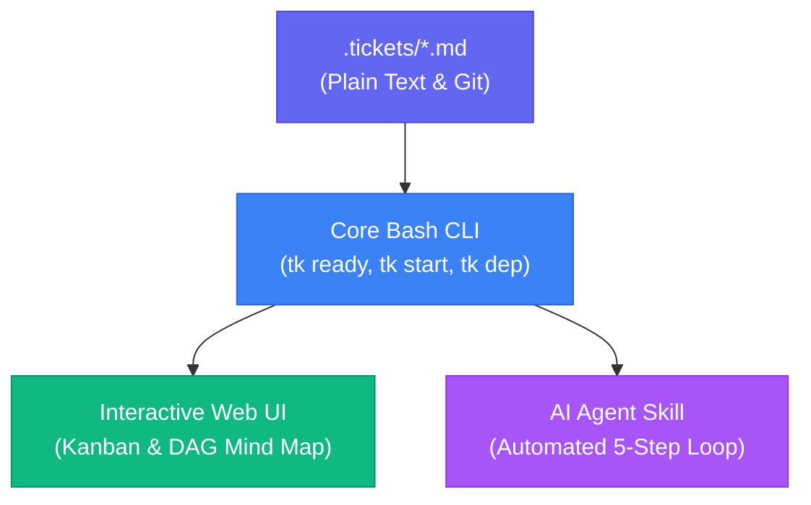

#  ticket (tk)

> Dependency-aware, Git-friendly task queue for humans and coding agents.

---

## Terminal Demo


---

## Architecture & Workflow



---

## Key Features

- **Plain Text Storage**: Tasks reside in `.tickets/*.md` files with YAML frontmatter, versioned directly in Git alongside the codebase.
- **DAG Dependency Tracking**: Native support for parent-child hierarchies, blockers, cycle detection, and automated downstream unblocking.
- **Portable Bash Core**: One Bash 3.2+ script using standard Unix tools; no Python or Node. `jq` is optional (only for `tk query` filters).
- **Safe for Concurrent Agents**: `tk start --claim` claims a ticket atomically under a per-ticket lock, exiting `3` if another agent got there first.
- **AI Agent Integration**: Deterministic 5-step operational loop, reusable agent skill (`agent-skill/tk/SKILL.md`), and machine-readable context endpoints.

---

## Official Plugins

Extend `ticket` with optional plugins discovered automatically via `$PATH`:

- **[Web UI (`tk webui`)](plugins/webui.md)**: Interactive 4-lane Kanban board, DAG Mind Map graph, table view, and background daemon manager.
- **[GitHub Import (`tk github`)](plugins/github.md)**: One-way import of GitHub issues and pull requests into local tickets.
- **[SCION Task Force (`tk scion-taskforce`)](plugins/scion-taskforce.md)**: Event-driven bridge from tickets to SCION coding agents: saving a `taskforce` ticket starts its SCION worker; humans review and close.

Learn how to write custom plugins in pure Bash or Python in the [Plugin Architecture Guide](plugins/architecture.md).

---

## Quick Installation

Install the zero-dependency Bash CLI or the full suite with the interactive Web UI:

```bash
git clone https://github.com/msampathkumar/ticket.git
cd ticket

# Full Suite (CLI + Web UI + Agent Skill) — default
./install.sh --full

# Core CLI only (pure Bash, no Python)
./install.sh --core
```

---

## Install Agent Skill via NPX

Install the agent skill for your AI coding assistant without cloning the repository:

```bash
npx github:msampathkumar/ticket agent-skill --install
```

---

## Machine-Readable Agent Documentation (llms.txt)

- [`/llms.txt`](llms.txt): Structured table of contents linking directly to all Markdown documentation files.
- [`/llms-full.txt`](llms-full.txt): Consolidated single-file documentation reference combining all specifications into one payload.
