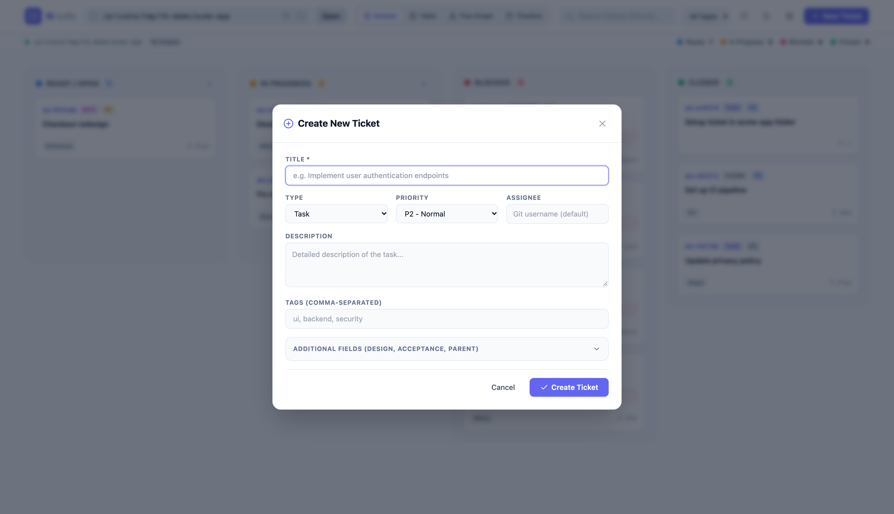
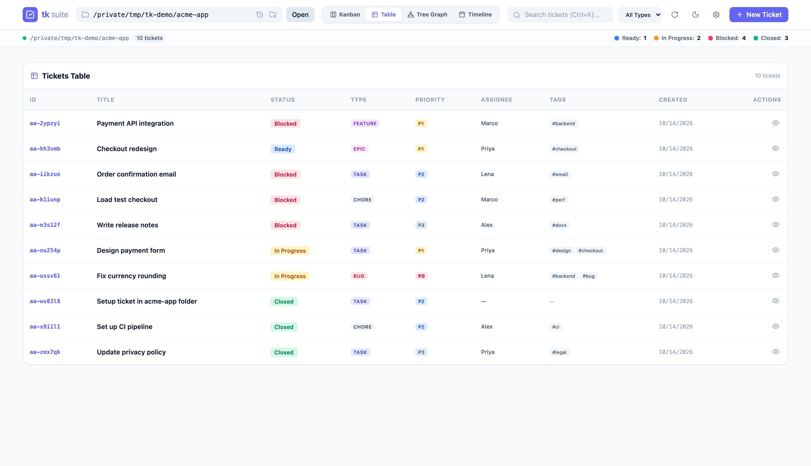

The **Web UI** (`tk-webui`) is an official plugin providing a visual dashboard running on default port **`8475`** (ASCII for **T** = 84, **K** = 75).

---

## Visual Showcase

| 4-Lane Kanban Board | Interactive Dependency Graph |
| :---: | :---: |
|  |  |

| Create & Edit Ticket | Table & Filter View |
| :---: | :---: |
|  |  |

---

## Key Features

- **4-Lane Kanban Board**: Drag-and-drop tasks between Ready, In Progress, Blocked, and Closed lanes.
- **Interactive Mind Map & DAG Graph**: Visualize task dependencies, filter by status, toggle top-down or left-to-right layouts, and expand/collapse subtrees.
- **Multi-View Switcher**: Switch between **Kanban**, **Table View**, **Dependency Tree Graph**, and **Timeline/Gantt View**.
- **In-Place Task Editing**: Edit titles, descriptions, tags, priorities, assignees, design notes, and acceptance criteria directly in the browser.
- **PR-Style Review Comments**: Chronological audit trail for review notes and comments (`Cmd+Enter` to submit).
- **Multi-Project Switcher**: Switch between repositories containing `.tickets/` on your system.
- **Auto-Refresh**: CLI and agent edits appear within about 3 seconds, without a manual reload.
- **Works Offline**: All scripts and styles are served locally; no CDN or network access is needed.
- **Full-Width Layout**: Views use the whole window on large screens.

---

## Installation

Install the Web UI plugin via the modular installer:

```bash
# Install Web UI plugin only
./install.sh --webui

# Or install as part of the full default suite (CLI + Web UI + Skill)
./install.sh --full
```

This installs `tk-webui` to `~/.local/bin/`. Ensure `~/.local/bin` is in your `$PATH`.

---

## Server & Daemon Commands

These match `tk webui help`:

```bash
# Foreground server (Ctrl+C to stop)
tk webui [directory] [--host HOST] [--port PORT] [--reload]

# Background daemon
tk webui server start [directory] [--host HOST] [--port PORT]
tk webui server status        # PID, URL, directory, start time, log path
tk webui server stop
tk webui server restart [directory] [--host HOST] [--port PORT]

# Shortcuts: tk webui start | status | stop | restart
tk webui version              # also --version, -v
tk webui help                 # also --help, -h

# Run from a checkout without installing
./run.sh [directory]
```

| Option | Default | Meaning |
| --- | --- | --- |
| `directory` | current directory | Project opened first (see below) |
| `--host` | `127.0.0.1` | Bind address (see [Security Model](#security-model)) |
| `--port` | `8475` | Listen port |
| `--reload` | off | Reload on code change (development, foreground only) |

### Which project opens

The browser picks the first available of:

1. `?dir=<path>` in the page URL.
2. The directory the CLI was started for (`tk webui <dir>`, else the current directory), served by `GET /api/config`.
3. The last project opened in this browser (only when the server was started without the CLI).

### Daemon behaviour

- **Start** refuses to launch if the port already accepts connections, then waits up to 10 seconds for the server to listen. If the process exits early or never listens, it reports the failure and the log path and exits non-zero.
- **Stop and status** check that the PID in `webui.json` is still a `tk_webui` process on the recorded port. If not (process gone or PID reused by another program), the state file is treated as stale and removed; no signal is sent.

---

## Security Model

The Web UI is a local, single-user tool with no authentication. It reads and writes ticket files, browses directories, and runs `tk` as your user, so it only accepts requests from your own machine:

- **Localhost only**: Binds to `127.0.0.1` by default.
- **Host allowlist**: Requests whose `Host` header is not `127.0.0.1`, `localhost`, or the `--host` value get `400`. This blocks DNS-rebinding attacks.
- **No CORS**: The UI is served from the same origin as the API, so no cross-origin access is granted. Other websites cannot read API responses.
- **Cross-origin writes rejected**: `POST`, `PUT` and `DELETE` requests with an `Origin` header that does not match the host get `403`.
- **Safe rendering**: Markdown is rendered with Marked and sanitised with DOMPurify; all other ticket text is HTML-escaped. A malicious ticket file cannot run script in the browser.
- **Pinned, vendored assets**: Tailwind, Lucide, SortableJS, Marked and DOMPurify are pinned copies in `tk_webui/static/vendor/`, with versions and sha256 hashes listed in [static/vendor/README.md](https://github.com/msampathkumar/ticket/blob/master/tk_webui/static/vendor/README.md).

!!! warning "Binding to other interfaces"
    `--host 0.0.0.0` (or `::`) exposes the UI to your network and disables the host allowlist. Anyone who can reach the port can read and change tickets and browse directories. Only do this on a trusted network; cross-origin writes are still rejected.

---

## Configuration & State

The Web UI manages its runtime state locally without requiring an external database:

- **Default Port**: **`8475`** (ASCII `T`=84, `K`=75).
- **Default Host**: `127.0.0.1` (localhost).
- **Daemon State File**: `~/.local/state/tk/webui.json` (records daemon PID, bound port, URL, and active project path).
- **Daemon Logs**: `~/.local/state/tk/webui.log` (appended; not rotated).
- **Project Registry**: `~/.local/state/tk/projects.json`, shared with `tk init` (`{"projects": [...]}`, written atomically).
- **Theme Engine**: Defaults to Indigo (`#6366f1`) with light/dark mode support; preferences persist in browser `localStorage`. In light mode, container and card borders use high-contrast slate-300 borders with dynamic brand-color hover transitions.

---

## Lanes and Blocked State

Lanes follow the same rules as `tk ready` and `tk blocked`:

- **Blocked**: an `open` or `in_progress` ticket with at least one dependency whose status is not `closed`. A dependency ID that matches no ticket also blocks.
- **Ready / Open**: an `open` ticket with no unresolved dependencies.
- **In Progress**: an `in_progress` ticket that is not blocked.
- **Closed**: closed tickets are never shown as blocked.
