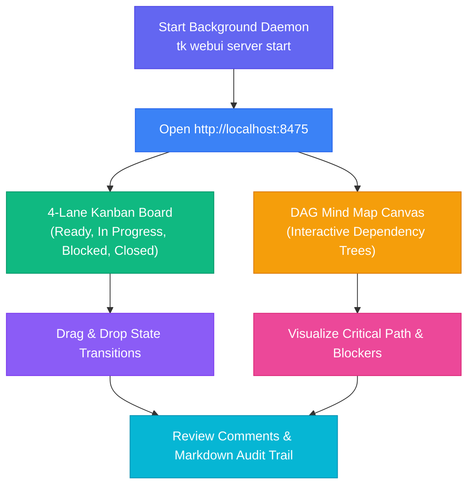
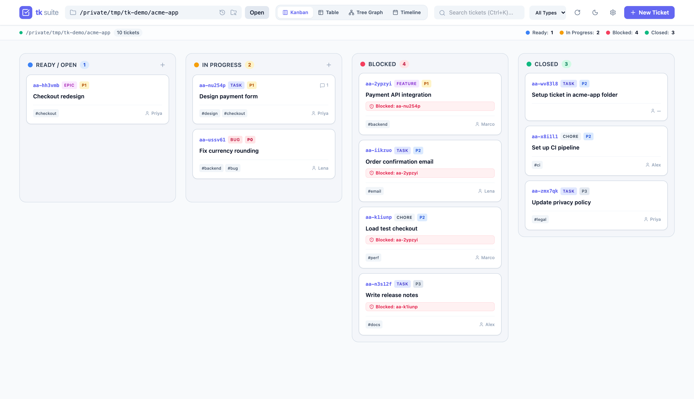
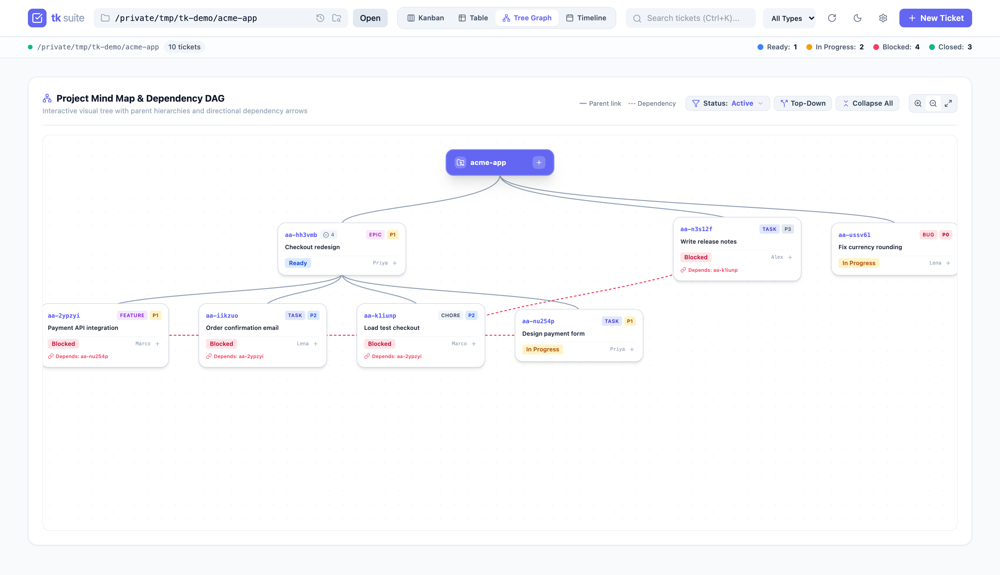

The **Web UI & Kanban Workflow** combines the command-line speed of `tk` with an interactive browser-based dashboard running on port **`8475`**.

---

## Lifecycle Overview



---

## Visual Highlights

| 4-Lane Kanban Board | DAG Mind Map Canvas |
| :---: | :---: |
|  |  |

---

## Step-by-Step Walkthrough

### 1. Launch the Background Daemon

Run the web dashboard persistently in the background, for the current directory or a given project:

```bash
tk webui server start              # or: tk webui server start /path/to/repo
```

Start fails with the log path if port `8475` is already in use; pass `--port` to pick another.

Check status or logs at any time:

```bash
tk webui server status
```

### 2. Visualize Sprint & Mind Map

Open [http://localhost:8475](http://localhost:8475) in your browser:

- Switch to **Mind Map View** to inspect dependencies, parent-child task links, and critical paths.
- Switch to **Kanban Board** to drag tasks between Ready, In Progress, Blocked, and Closed lanes. Blocked and Ready match `tk blocked` and `tk ready`.
- Leave the tab open while you or your agents work: changes made with `tk` appear within about 3 seconds. Refreshes wait while a ticket form is open or a card is being dragged.
- Open another project with `?dir=/path/to/repo` in the URL or the folder picker.

### 3. Review & Audit Notes

- Open any task drawer to review design notes and acceptance criteria.
- Append chronological audit notes with `Cmd+Enter` (macOS) or `Ctrl+Enter` (Linux/Windows).

### 4. Sharing with a Team

The Web UI is localhost-only and has no login. Each teammate runs it on their own machine against their own checkout; tickets are shared through Git. Binding to `0.0.0.0` exposes read/write access to anyone on the network. See the [Security Model](../plugins/webui.md#security-model).
